# PicoClaw for LILYGO UI

[English](README.md) | **简体中文**

PicoClaw 是面向 LILYGO UI 的独立、响应式应用，用于连接本地
[PicoClaw](https://github.com/sipeed/picoclaw) 运行时进行聊天。它在一个
AppKit 应用中提供模型提供商和聊天频道配置、运行时安装、Gateway 控制、活动日志，
以及适合触摸操作的聊天界面。项目使用 C++17、LILYGO UI AppKit 和 LVGL 9.5 构建，提供 CM0 ARM64 Linux 软件包以及用于开发和测试的 SDL2 桌面模拟器。

产品标识如下：

```text
Package and executable: lilygo-ui-picoclaw
Application ID:         cc.lilygo.ui.PicoClaw
```

## 预览

<p>
  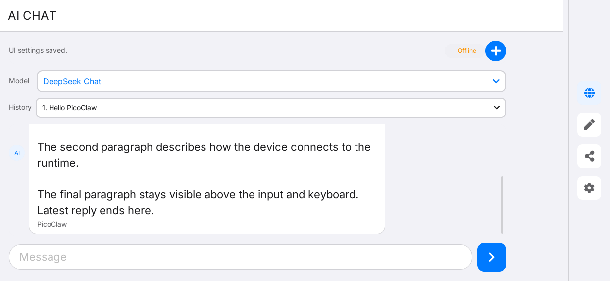
  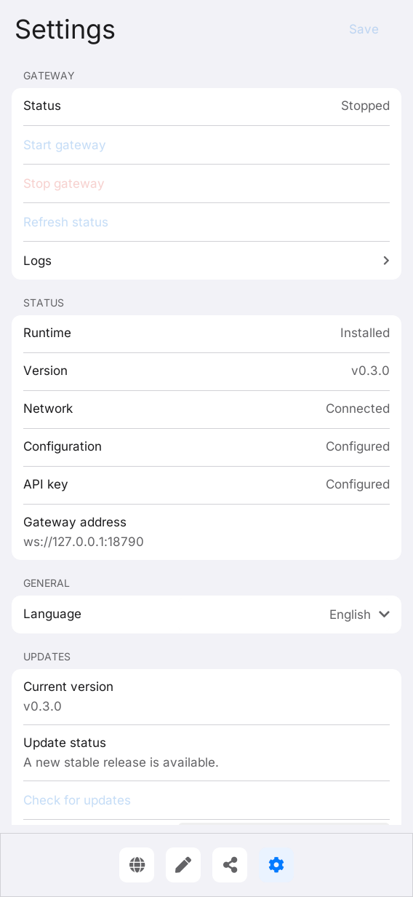
</p>

<p>
  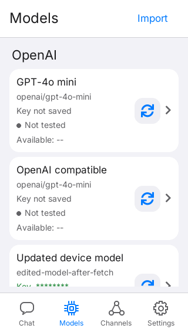
  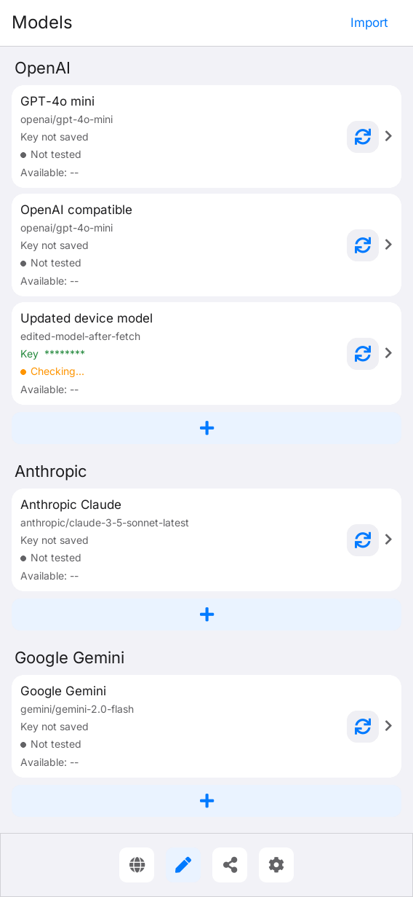
  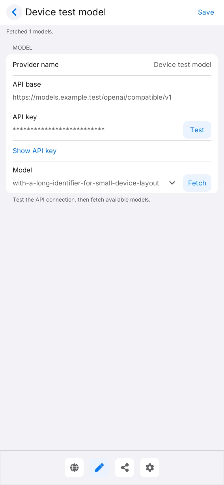
</p>

<p>
  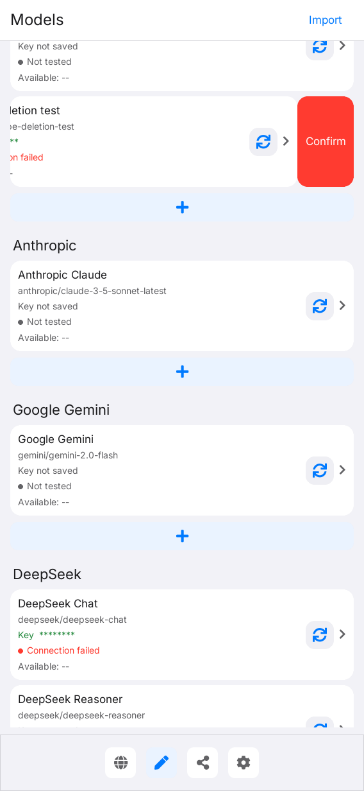
  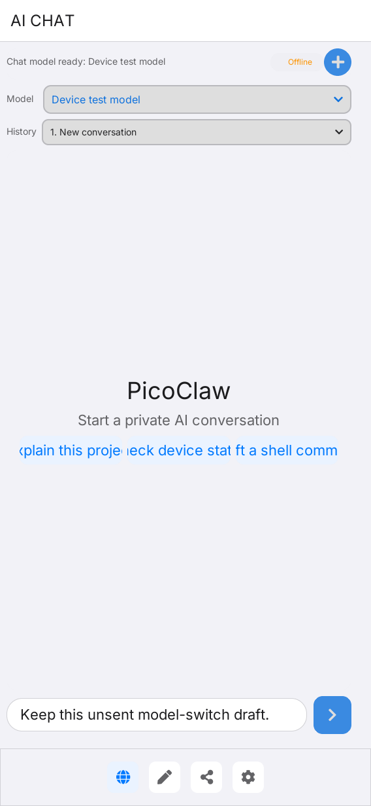
</p>

<p>
  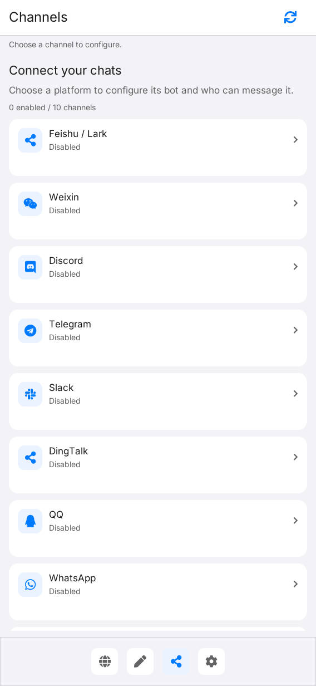
  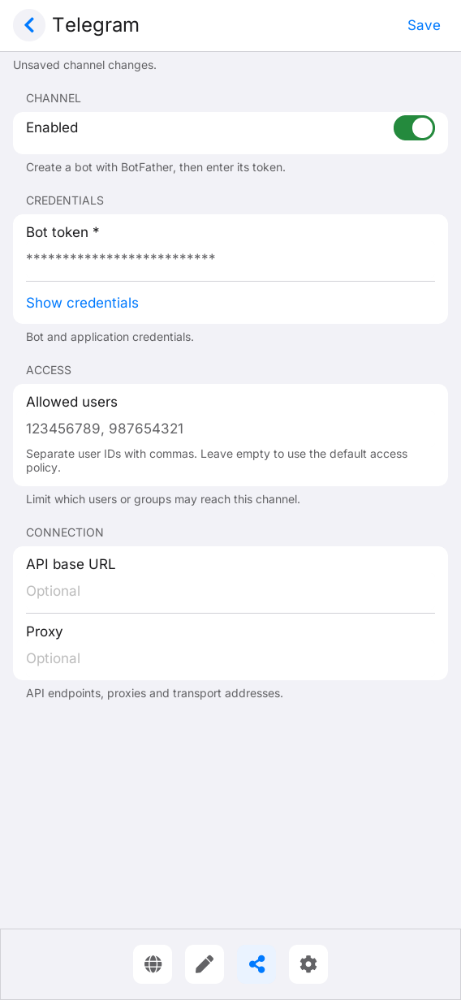
</p>

<p>
  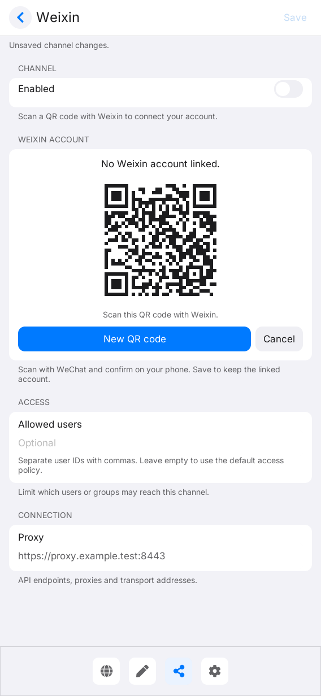
  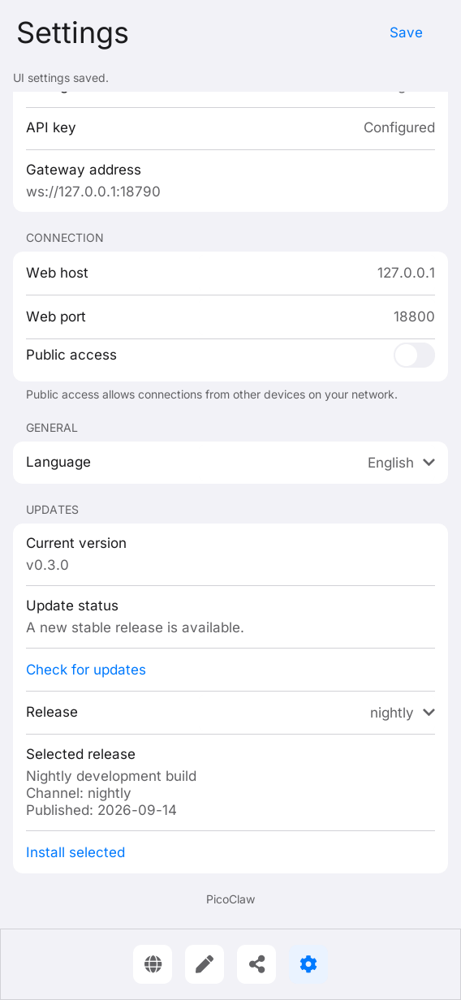
</p>

## 功能

- 保存聊天历史，并分别显示用户消息和 PicoClaw 消息。
- 在 Chat 页面的 **Model** 菜单中直接选择已保存的模型。切换模型会保留当前会话和未发送的草稿，确认所选配置后即可继续发送；列表中包含提供商名称。
- **New chat** 会保留之前的会话；使用 **History** 切换并继续已有会话。较长的会话会在最近 32 条消息上方提供 **Earlier messages**，每个会话都有独立的后端会话。
- 支持响应式横竖屏布局，并集成 LVGL 键盘。
- 提供四个主页面：**Chat**、**Models**、**Channels** 和 **Settings**。
- 采用 iPhone 风格导航，图标和标签均匀排列，当前标签为蓝色，底部带细分隔线的白色栏。Chat 使用对话气泡图标，Models 使用芯片图标，Channels 使用连接节点图标，Settings 使用齿轮图标。宽屏会在侧边栏使用相同的带标签项目；键盘打开时会暂时隐藏导航。
- 采用 iOS 风格设置页，使用带内缩的分组行，提供语言偏好和始终可见的 Save 操作。Gateway 状态、启动/停止和刷新控件位于顶部；打开 **Settings → Logs** 可查看并刷新活动日志。运行时详情包含 Gateway 地址。窄屏上的长值会使用整行显示。
- 提供可直接使用的 OpenAI、Anthropic、Google Gemini、DeepSeek 和 Ollama 配置，以及自定义 OpenAI 兼容配置。
- 支持编辑提供商名称、API base、模型 ID 和 API key。
- Models 页面支持添加、编辑、删除和导入已保存的模型配置。每个模型保留自己的 API key，可在 Chat 的模型菜单中选择。模型按 OpenAI、Anthropic、Google Gemini、DeepSeek 和 Ollama 的顺序分组。每组都有 **+** 按钮，会预填该提供商的 API base 和模型格式。竖屏使用单列，宽屏时每组显示两列配置。编辑时 Save 按钮和当前焦点字段会保持在键盘上方；保存后返回列表中的更新配置。
- 点击配置即可编辑。为编辑器和配置标题设置提供商名称。编辑器的样式与 Settings 一致，包含 API base、带掩码的 API key 和 **Test**，以及带 **Fetch** 的可编辑 **Model** 字段。可以直接输入模型 ID，也可以通过下拉菜单选择获取到的模型。内部模型别名由应用自动管理；编辑器不提供别名、映射或删除控件。选择并保存时保留服务端返回的模型 ID，不会添加提供商前缀。提供商分组与模型 ID 分开保存。
- 向左滑动模型配置可显示 **Delete**，确认后删除；向右滑动可关闭操作区，垂直滚动仍可浏览列表。
- 每个配置显示 API 连接状态和剩余额度。进入 **Models** 后，应用会在后台自动检查已保存的配置；API base 和 key 相同的模型会共享一次查询。没有 key 的远程预设会跳过，本地 Ollama 无需 key 即可检查。结果更新期间仍可导航、编辑和聊天；返回 **Models** 时会刷新结果并复用仍在进行的检查。使用配置上的刷新图标，或编辑器中的 **Test** / **Fetch**，可以手动更新。
  结果仅对当前应用会话中的 API base 和 key 生效。DeepSeek、OpenRouter、SiliconFlow、Sub2API 及兼容的计费 Gateway 会提供余额；其他提供商显示 unavailable/not provided，本地 Ollama 显示 not metered。余额查询失败不会将一个正常工作的 API 标记为离线。
  对自定义提供商，应用首先使用配置的 Bearer API key 请求 `GET /v1/usage`，接受 cc-switch 使用脚本中的 `remaining`、`quota.remaining` 或带 `unit` 的 `balance`（默认单位为 USD）。以 `/v1` 结尾的 API base 不会重复添加该后缀。`/user/balance` 以及旧版 `/dashboard/billing/subscription` + `/dashboard/billing/usage` API 仍作为后备。Sub2API 的无限制订阅若返回 `remaining: -1`，会显示 **Unlimited**。应用不会导入任意 cc-switch 脚本或 New API 的账户 access-token 查询；这些接口可能需要与 API key 不同的凭据。
- 运行时状态、安装、agent、Gateway 和日志命令均为非阻塞操作。
- 提供 **Channels** 页面配置聊天集成。选择频道，编辑凭据和选项，打开或关闭 **Enabled**，然后按 **Save**。相关选项按 Credentials、Security、Access、Behavior、Connection、Webhook 和 Advanced 分组，与 PicoClaw Web UI 保持一致。敏感字段会被掩码；保存失败时会保留草稿以便修改。保存后从 **Settings** 重启 Gateway，使新配置生效。
- 配置、工作区、状态和运行时目录均使用应用私有的 XDG 路径。
- ARM64 设备 deb 软件包内置 PicoClaw 运行时，因此在设备上安装或启动应用无需下载运行时。Linux（ARM64、x86_64、ARMv7）仍支持单独下载运行时。macOS 模拟器默认使用官方 PicoClaw Docker 镜像，不会在 Mac 上安装原生 PicoClaw 二进制文件。

## 开发环境搭建

项目标识、版本和软件包元数据由 [`lpm.toml`](lpm.toml) 提供。
[`CMakePresets.json`](CMakePresets.json) 定义了 `host-simulator` 和 `cm0-cross` 配置。
所有命令均应在仓库根目录执行。

### 获取源码

```sh
git clone --recurse-submodules https://github.com/LILYGO-UI/picoclaw.git
cd lilygo-ui-picoclaw
```

已有仓库可初始化锁定版本的依赖：

```sh
git submodule update --init --recursive
```

项目直接使用 `third_party/cm0-appkit`，模拟器无需单独安装 AppKit。默认使用其中附带的
LVGL 9.5.0 归档，两个预设均禁用 LVGL 网络下载。

### 主机依赖

需要 CMake 3.21 或更高版本、支持 C++17 的编译器、`pkg-config`、SDL2、LPM、用于测试的
Python 3，以及仓库中已检出的 AppKit 子模块。AppKit 还需要 `patch` 来应用附带的 LVGL 补丁；
SDL2 提供主机显示，FreeType 负责字体渲染。运行时和测试脚本会使用 `curl`、Python 3 和
系统 CA 证书。

#### Debian / Ubuntu

```sh
sudo apt update
sudo apt install build-essential cmake git pkg-config patch libsdl2-dev \
  libfreetype6-dev curl ca-certificates python3 python3-venv python3-pip
```

较旧发行版需要先将 CMake 和 Python 升级到所需版本。

#### macOS

按需安装 Xcode Command Line Tools，并通过 [Homebrew](https://brew.sh/) 安装依赖。
完成 Homebrew 的 Shell 配置，确保 `brew` 及其安装的工具位于 `PATH` 中：

```sh
xcode-select --install
brew install git cmake pkg-config patch sdl2 freetype curl python
```

### LPM

CMake 在配置阶段调用 `lpm metadata --format cmake`。使用 Python 3，在项目虚拟环境中安装 LPM：

```sh
python3 -m venv .venv
. .venv/bin/activate
python -m pip install "git+https://github.com/LILYGO-UI/lpm.git"
lpm --version
```

每次打开新终端后，先执行 `. .venv/bin/activate` 再使用 `lpm`。CMake 会同时搜索 `.venv/bin`
和 `PATH`。如需指定其他位置的 LPM，可在配置时传入
`-DLPM_EXECUTABLE=/absolute/path/to/lpm`。

构建前检查主机环境：

```sh
cmake --version
python --version
pkg-config --modversion sdl2 freetype2
lpm metadata --format cmake
```

### 设备交叉编译器

仅构建桌面模拟器时可以跳过此步骤。设备构建需要在开发机上单独安装 AArch64 Linux 交叉编译器。

**Debian / Ubuntu：**

```sh
sudo apt install gcc-aarch64-linux-gnu g++-aarch64-linux-gnu
```

**Apple Silicon macOS：**

```sh
brew install aarch64-unknown-linux-gnu
```

BSP 工具链要求 `PATH` 中存在以下名称的可执行文件：

```sh
aarch64-linux-gnu-gcc --version
aarch64-linux-gnu-g++ --version
```

SDK 对主机和编译器的要求详见 [CM0BspBuilder](https://github.com/LILYGO-UI/CM0BspBuilder)。
BSP 提供目标平台的头文件和库，但不会安装开发机所需的交叉编译器。

## 构建与测试

### 桌面模拟器

直接使用 CMake 构建并运行测试：

```sh
cmake --preset host-simulator
cmake --build --preset host-simulator --parallel
ctest --preset host-simulator
```

### 测试

| 测试 | 覆盖内容 |
| --- | --- |
| picoclaw-control | 助手状态、安装、Gateway 生命周期和配置持久化 |
| picoclaw-provider | 提供商配置、模型发现和用量响应 |
| picoclaw-channels | 频道加载、编辑、敏感字段和异步保存 |
| picoclaw-weixin | 微信二维码绑定和轮询状态转换 |
| picoclaw-releases | 版本列表、校验和验证、安装及回滚 |
| picoclaw-core | 不初始化 LVGL 的模型和异步客户端规则 |
| picoclaw-protocol | Pico Protocol 帧和事件解析 |
| picoclaw-websocket | POSIX WebSocket 连接和帧处理 |
| picoclaw-view-model | ViewModel 命令和 Subject 发布 |
| picoclaw-render-* | 四种视口下 Chat、Models、Channels 和 Settings 的渲染与交互 |

渲染测试会在 `320x568`、`568x1232`、`1232x568` 和 `1024x768` 下覆盖 Chat、Models、Channels
和 Settings 导航。PPM 快照写入 `build/host-simulator/`。

### 桌面运行时

主机模拟器连接开发机上的真实 PicoClaw 运行时。构建 UI 不会安装该运行时。在 macOS 上，
请先安装 Docker Desktop。首次启动时 Settings 显示 `Not installed`；可在那里使用
**Install / update**，或运行：

```sh
sh scripts/picoclaw-control.sh install
sh scripts/picoclaw-control.sh status
```

macOS 安装器会拉取 `docker.io/sipeed/picoclaw:latest`，并将应用已有的配置、安全文件、工作区
和日志挂载到容器中。Gateway 控制使用名为 `lilygo-picoclaw-gateway` 的托管 Docker 容器。
从终端安装后请重启模拟器，使其刷新运行时状态。在 **Models** 中保存模型配置和 API key，
然后在 Chat 的 **Model** 菜单中选择它，才能开始聊天。

内置配置使用 PicoClaw 的提供商/模型前缀和提供商端点：

| 提供商 | 模型示例 | API base | API key |
| --- | --- | --- | --- |
| OpenAI | `openai/gpt-4o-mini` | `https://api.openai.com/v1` | 必需 |
| Anthropic | `anthropic/claude-3-5-sonnet-latest` | `https://api.anthropic.com/v1` | 必需 |
| Google Gemini | `gemini/gemini-2.0-flash` | `https://generativelanguage.googleapis.com/v1beta` | 必需 |
| DeepSeek | `deepseek/deepseek-chat` | `https://api.deepseek.com/v1` | 必需 |
| Ollama | `ollama/llama3.2` | `http://127.0.0.1:11434/v1` | 不需要 |

Ollama 必须与 PicoClaw 运行时位于同一主机。当运行时位于 Docker 中时，请将配置的 API base
设置为容器可访问的地址，例如 `http://host.docker.internal:11434/v1`。

也可以通过 `PICOCLAW_BIN` 或 Settings 中的二进制路径选择已有 PicoClaw 二进制。否则，控制
助手会依次优先使用与已安装控制助手并列的运行时、旧版托管安装，以及 `PATH` 中的运行时。
从 **Updates** 明确安装的版本优先于内置运行时。安装版本前必须清空自定义二进制路径。

### CM0 设备构建与打包

```sh
cmake --preset cm0-cross
cmake --build --preset cm0-cross --parallel
cpack --config build/cm0-cross/CPackConfig.cmake -B dist
```

Linux ARM64 构建默认内置
[`nightly` ARM64 版本](https://github.com/sipeed/picoclaw/releases/download/nightly/picoclaw_Linux_arm64.tar.gz)。
CMake 会在开发机构建机上下载并缓存归档，检查核心是否为 ARM64 ELF 可执行文件，并将其与控制
助手一起安装到 `/usr/lib/lilygo-ui-picoclaw/picoclaw`（使用标准 `/usr` 预设）。deb 中还会包含
上游许可证、README 和归档来源信息。macOS 模拟器不会下载或打包 Linux 二进制文件。

如需离线或可复现构建，请提供已保存的归档及其 SHA-256：

```sh
cmake --preset cm0-cross \
  -DLILYGO_PICOCLAW_RUNTIME_ARCHIVE=/absolute/path/picoclaw_Linux_arm64.tar.gz \
  -DLILYGO_PICOCLAW_RUNTIME_SHA256=<archive-sha256>
cmake --build --preset cm0-cross --parallel
cpack --config build/cm0-cross/CPackConfig.cmake -B dist
```

`nightly` URL 会随时间变化。请将归档和校验和放在一起，以便重建同一版本。若要从相同 URL
获取更新的 nightly，请在重新配置前删除 `build/cm0-cross/picoclaw-runtime/downloads/`，并在
设置过预期校验和时同步更新。`LILYGO_PICOCLAW_RUNTIME_URL` 可选择其他归档来源，
`LILYGO_PICOCLAW_BUNDLE_RUNTIME=OFF` 可在运行时由其他方式提供时禁用打包。应用内更新后，
内置副本仍会保留；更新 deb 不会替换用户明确选择的版本。

在目标设备上安装并从 Launcher 打开 **PicoClaw**：

```sh
sudo apt install ./lilygo-ui-picoclaw_0.1.0_arm64.deb
lilygo-ui-picoclaw
```

应用会加载启动用户已有的配置。全新安装时，在 **Models** 中添加提供商配置，输入模型/API
详情并按 **Save**，然后在 Chat 的 **Model** 菜单中选择它。之后 Chat 可以直接调用内置 agent；
使用 **Settings → Start gateway** 可用同一配置启动 Gateway。Settings 顶部可以停止 Gateway。
安装 deb 不会启动系统服务，也不会在 root 的 home 目录下创建配置。

在 Linux 设备上，Gateway 使用已选择的版本作为原生后台进程运行；初始版本为
`/usr/lib/lilygo-ui-picoclaw/picoclaw`。控制助手使用 `nohup` 和 `setsid` 启动它，传递
`PICOCLAW_HOME` 和 `PICOCLAW_CONFIG`，并停止记录的 PID。关闭 UI 后 Gateway 仍会运行。
即使环境中存在 `PICOCLAW_DOCKER=yes`，设备也不会使用或要求 Docker。同一用户可以在终端中使用
相同的控制命令：

```sh
/usr/lib/lilygo-ui-picoclaw/picoclaw-control gateway-start
/usr/lib/lilygo-ui-picoclaw/picoclaw-control status
/usr/lib/lilygo-ui-picoclaw/picoclaw-control gateway-stop
```

如果设备使用自定义配置目录，请以
`PICOCLAW_CONFIG_DIR=/path/to/config lilygo-ui-picoclaw` 启动。界面和控制助手都会使用该目录
中的 `ui-settings.conf` 和 `config.json`，并将 `.security.yml` 放在 JSON 文件旁边。软件包升级
时，用户可写目录中的现有配置和 key 会保留。

### 常见问题

| 现象 | 处理方法 |
| --- | --- |
| lpm is required to read project metadata | 在项目虚拟环境中安装 LPM，将其加入 PATH，或设置 LPM_EXECUTABLE。 |
| 找不到 LilyGoUI 或附带的 LVGL | 执行 git submodule update --init --recursive 初始化 AppKit 子模块。 |
| 缺少 SDL2 或 FreeType | 安装主机开发依赖；交叉编译时检查 CM0 sysroot。 |
| macOS 上 Docker 运行时控制失败 | 启动 Docker Desktop，并确认 docker info 可以正常执行。 |
| 内置运行时下载失败 | 检查 GitHub 访问和磁盘空间，然后重新配置，或提供 LILYGO_PICOCLAW_RUNTIME_ARCHIVE。 |
| 设备上的 Gateway 无法启动 | 检查所选二进制、config.json、.security.yml，以及 XDG 状态目录下的活动日志。 |

## 频道配置

打开 **Channels** 可查看可用集成及其已配置的启用状态：Feishu / Lark、Weixin、Discord、Telegram、
Slack、DingTalk、QQ、WhatsApp、LINE 和 OneBot。选择集成后可编辑频道专属字段，例如机器人 token
或应用凭据、允许的发送者和连接选项。**Enabled** 开关决定 PicoClaw 是否启动该频道。列表显示
配置状态，不会验证频道是否已连接到对应服务。

按 **Save** 将频道设置写入运行时配置。保存是异步的；发生错误时，编辑器会显示错误并保留已输入的值，
以便修改和重试。键盘打开时 Save 和返回操作仍保持可见，调整窗口大小也会保留草稿。使用列表中的
刷新操作，可重新加载应用外部修改的配置。

打开 Weixin，按 **Bind Weixin**，使用微信扫描二维码并在手机上确认。应用直接联系腾讯 iLink 服务；
Web UI 和 Gateway 无需运行。应用每两秒检查一次，二维码五分钟后过期。等待期间可使用 **New QR code**
和 **Cancel**。确认的账号会显示在表单中，其 token 始终隐藏。打开频道的 **Enabled** 并按 **Save**，
即可私密保存凭据。如果 Gateway 已运行，Weixin 保存后应用会自动重启它，使新 token 生效。

取消、过期或失败都会保留之前的配置。其他频道修改保存后仍需要重启 Gateway。

配置会在 Gateway 下次启动时生效。如果 Gateway 正在运行，请保存后使用 **Settings → Stop gateway**，
再使用 **Start gateway**。频道设置不会测试普通频道连接，也不会发送测试消息；Weixin 绑定是该频道明确的
二维码授权流程。

## Gateway 更新

在设备上打开 **Settings → Updates → Check for updates**。应用会读取公开
[GitHub Releases](https://github.com/sipeed/picoclaw/releases) API 的全部分页，并列出 stable、prerelease
和 nightly 版本。页面显示最新 stable 版本，以及已安装的 stable/nightly 运行时是否有更新。选择一个版本，
按 **Install selected** 即可安装该准确 tag。

没有匹配平台归档的版本仍会显示，但无法安装。旧归档若包含不兼容的 CLI，会在切换当前运行时之前验证失败。

下载使用所选版本的 SHA-256 摘要；如果没有摘要，则使用其校验和文件作为后备。缺少校验和、网络错误、GitHub
访问频率限制和不完整的版本响应都会产生错误，并保留当前选择。可变的 `nightly` 通过归档摘要检查，因此同一
tag 下的新构建也能被检测到。

更新文件存储在 `$PICOCLAW_HOME/versions/` 下（默认是
`~/.local/share/lilygo/ui/picoclaw/versions/`），由 `bin/active-picoclaw` 原子选择当前版本。
更新不需要 root 权限，也不会修改 deb 所拥有的文件。Gateway 正在运行时，下载期间服务保持可用；下载完成后，
它会使用新二进制和现有配置重启。如果启动或健康检查失败，更新器会恢复之前的选择和配置，并尝试重启之前的
Gateway。已停止的 Gateway 会继续保持停止状态。更新操作和 Gateway 控制操作共享一个锁，不会并发切换运行时。

以下是以 UI 用户身份执行的终端等价命令：

```sh
/usr/lib/lilygo-ui-picoclaw/picoclaw-control check-updates
/usr/lib/lilygo-ui-picoclaw/picoclaw-control install-release v0.3.1
```

deb 依赖中包含 Python 3 和 util-linux。版本选择只针对原生 Linux 运行时；macOS 模拟器继续使用其 Docker 镜像
更新操作。


## 运行时数据

已安装的控制助手遵循 XDG 基础目录规范：

```text
$XDG_DATA_HOME/lilygo/ui/picoclaw/       runtime and workspace
$XDG_CONFIG_HOME/lilygo/ui/picoclaw/     config.json and .security.yml
$XDG_STATE_HOME/lilygo/ui/picoclaw/      logs and gateway PID
```

会话标题、消息和选中的会话会自动保存到
`$XDG_STATE_HOME/lilygo/ui/picoclaw/conversations.dat`，文件模式为 `0600`。
`PICOCLAW_STATE_DIR` 可覆盖该目录，`PICOCLAW_HISTORY_DIR` 可只覆盖会话归档目录。存储错误会显示在
聊天状态中；无法读取的归档会保留，不会被替换。关闭应用中断的响应在重新打开后会标记为 interrupted。

包括语言在内的 UI 偏好以及兼容旧版 FUI 的设置，会保存到
`$XDG_CONFIG_HOME/lilygo/ui/picoclaw/ui-settings.conf`，也可以由 `PICOCLAW_UI_SETTINGS` 指定路径。
应用固定使用一种 iOS 风格的浅色外观，已移除可选主题。加载设置时会忽略旧的 `theme=` 行，并在下次保存设置时
省略这些行。

Settings 没有 Connection 分组，也没有 Web host、Web port 和 Public access 控件，因为目标设备不提供 Web
管理服务。旧版 `host`、`port`、`public_mode`、`binary_path` 和 `arguments` 值仍保持兼容，并在保存偏好时保留。
旧版 Web port 只提供 Web URL 元数据，不会改变 Gateway 的监听端口。

Models 页面会将提供商显示名称、内部别名、模型 ID、API base 和 API key 以原子写入方式保存到这些偏好旁边的
`models.conf`，文件模式为 `0600`。`PICOCLAW_MODELS_PATH` 可覆盖此文件。列表和编辑器会掩码 key，编辑时可使用
明确的 Show 操作。**Import existing models** 会读取运行时的 `config.json` 和 `.security.yml`，添加缺失模型，
并为匹配的条目补齐缺失 key，同时保留已有保存值。**Save** 会将模型保留在该库中；Chat 模型选择器会将其应用到
运行时，并在启用 Send 前确认它已准备就绪。

运行时状态刷新会保留已编辑的条目，不会为相同内部别名重新添加旧配置。保存时会修复旧版本留下的重复内部别名，
但不会在配置之间移动 key。切换模型会保留其他运行时模型、key 和服务设置。CLI 消息会明确写出已确认的模型别名。
在本地 WebSocket 模式下，切换模型还会重启托管 Gateway 并验证其配置。无法通过这些本地控件切换远程 WebSocket
Gateway。切换失败后会禁用发送，直到成功重新选择模型。编辑已选模型的 API 详情后，也需要重新选择它才能应用修改。

API key 保存在 `config.json` 旁边的 PicoClaw 私有 `.security.yml` 中，文件模式为 `0600`。当配置目录还没有安全文件时，
运行时目录中的已有 key 会自动复制过去。API key 和聊天提示会通过标准输入发送给助手，不会插入 Shell 命令，也不会暴露在
进程列表中。提供商 key 不会打印在状态或活动输出中。

运行时助手支持以下部署覆盖变量：

```text
PICOCLAW_BIN
PICOCLAW_HOME
PICOCLAW_CONFIG
PICOCLAW_CONFIG_DIR
PICOCLAW_STATE_DIR
PICOCLAW_UI_SETTINGS
PICOCLAW_GATEWAY_PORT
PICOCLAW_TRANSPORT
PICOCLAW_GATEWAY_TOKEN
PICOCLAW_RELEASE_TAG
PICOCLAW_RELEASE_URL
PICOCLAW_RELEASE_SHA256
PICOCLAW_DOCKER
PICOCLAW_DOCKER_IMAGE
PICOCLAW_DOCKER_CONTAINER
```

在 macOS 上，`PICOCLAW_DOCKER` 默认值为 `yes`。使用原生 macOS 开发二进制时可将其设为 `no`。
Linux 始终使用原生进程并忽略该覆盖；Docker 镜像和容器设置只适用于 macOS 模拟器。

`LILYGO_PICOCLAW_CONTROL` 可选择其他控制助手，用于集成测试或定制部署。

## 架构

UI 遵循仓库的 Model-View-ViewModel 边界：

```text
LVGL View -> PicoClawViewModel -> PicoClawModel
                         |
                         +-> PicoClawClient -> picoclaw-control / Pico Protocol WebSocket
```

`PicoClawClient` 在一个工作线程中运行助手命令，并通过 LVGL 线程轮询将结果发布回来。关闭应用时，
会先终止活动助手的进程组，再等待工作线程结束。应用只通过 `find_package(LilyGoUI CONFIG REQUIRED)` 使用 AppKit，
源代码和构建均不依赖 Launcher。

交互模型参考了 `Xinyuan-LilyGO/T-Display-K230` 中的 PicoClaw 功能，基于 commit
`bb831ab358b66f5bd9a87ecd7c580fee4537492e`，并移除了 K230 专属路径、Launcher 偏好和 riscv64 运行时。

## Android FUI 参考实现

Android/Flutter 参考实现维护在
[`sipeed/picoclaw_fui`](https://github.com/sipeed/picoclaw_fui)。其聊天 UI 位于
[`lib/src/ui/chat_page.dart`](https://github.com/sipeed/picoclaw_fui/blob/main/lib/src/ui/chat_page.dart)，
服务和配置流程位于 `dashboard_page.dart`、`config_page.dart` 和 `log_page.dart`。
本项目将相同的聊天操作和运行时控制移植到 LVGL，包括连接状态胶囊、新建会话操作、助手/用户头像、圆角消息气泡
和胶囊式输入框。Gateway 控制和状态位于 Settings 顶部，活动日志在其 **Logs** 子菜单中。模型配置在 **Models** 中管理。
CM0 后端保留已有 Linux 助手路径；Android WebSocket 协议和服务桥接见
[docs/picoclaw-fui-port.md](docs/picoclaw-fui-port.md)。

## 文档

| 指南 | 内容 |
| --- | --- |
| [应用总览](docs/00-overview.md) | 产品范围、工程结构、运行时目录、响应式设计和验证 |
| [UI 开发规范](docs/01-user-interface.md) | 架构边界、视觉规范、字体、响应式布局、对象生命周期和 UI 验收 |
| [picoclaw_fui 迁移说明](docs/picoclaw-fui-port.md) | Android/Flutter 功能到 LVGL 的聊天、运行时和 Settings 映射 |

## 致谢

本项目使用 [LILYGO UI AppKit](https://github.com/LILYGO-UI/cm0-appkit) 和
[LVGL](https://lvgl.io/)，运行时来自 [PicoClaw](https://github.com/sipeed/picoclaw)。
Android/Flutter 交互参考了 [`sipeed/picoclaw_fui`](https://github.com/sipeed/picoclaw_fui)，
设备端的交互模型参考了 `Xinyuan-LilyGO/T-Display-K230`。
运行或分发应用时，请遵守相关项目和服务提供方的使用政策。
